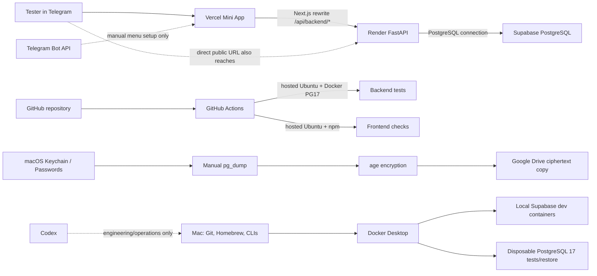

# FinOps и допуск к внешнему MVP-тестированию

> **Исторический статус на 18.10.2026:** на тот момент описывались server-side admission allowlists и незавершённый production rollout. Последующее продуктовое решение отменило отдельные core/tester admission и tester-pause controls: backend допускает любой валидный Telegram `initData`. Account-level billing controls и актуальная совместимость deployment требуют проверки по текущим provider данным.

Документ описывает найденные зависимости и безопасный порядок допуска ограниченной группы. Он не подтверждает точные счета, не задаёт SLA и не заменяет [deployment runbook](backend/production-deployment-runbook.md), [backup/restore runbook](backend/backup-restore-runbook.md) или [security runbook](backend/security.md). Все цены и квоты ниже — опубликованные условия провайдеров на дату аудита, если не помечены как account-specific. Не считать их фактическим расходом проекта.

## 1. Метод и категории

- **VERIFIED** — подтверждено текущим исходным кодом, конфигурацией, read-only provider inventory или локальным состоянием на дату проверки.
- **INFERRED** — вывод из подтверждённого поведения, но это не измерение реального billing/production traffic.
- **UNKNOWN** — нужно проверить в соответствующем provider/account dashboard или отдельным разрешённым audit.
- Классы использования: **Production**, **Development**, **Operations**, **Dormant**. Установка CLI сама по себе не означает production usage.
- **Деньги**, **квоты**, **ресурсы компьютера** и **операционные риски** учитываются отдельно. Сумма фактических счетов не была получена; нулевой счёт не заявляется.

## 2. Единая инфраструктурная карта

Vercel rewrites `/api/backend/*` to `BACKEND_API_ORIGIN`; the value was not read or disclosed. Render service has a public `onrender.com` hostname and provider access rule `0.0.0.0/0`, so hiding the Mini App URL is not an API boundary. Authenticated application routes still validate backend sessions; health, readiness and Telegram login routes are unauthenticated. No runtime Supabase Auth, Storage upload/download, Vault, AI API, maps, mail delivery, background worker, scheduled job or third-party error-monitoring service was found in the current application code/config. Telegram Bot API usage found in repository is an operator script to set the menu button, not a per-user backend call.

Backup is an **Operations** chain: PostgreSQL 17 `pg_dump` → password from Keychain → private local archive → `age` encryption → Google Drive ciphertext. Restore verification is a separate local chain: backup/checksum → Docker Desktop → PostgreSQL 17 disposable container → `pg_restore`. The project runbooks record a successful synthetic storage recovery and a local schema/data restore; neither is production restore proof.

## 3. Dependency inventory

| Dependency / class | Фактическое использование, обязательность и доказательство | Деньги, бесплатные лимиты и автоматические начисления | Локальные ресурсы, отказ и допустимая альтернатива | Действие оператора |
|---|---|---|---|---|
| **Vercel — Production** | `travel-friend-mini-app`; production alias `travel-friend-mini-app.vercel.app`. Используется Mini App; нужен frontend. Custom domain в project domain list не найден. **VERIFIED**. | Account plan, payment method, usage и счёт **UNKNOWN**. Hobby — бесплатный personal/non-commercial plan; превышение включённого использования обычно приостанавливает функции до reset. Pro допускает usage billing сверх включённых credit, если не настроен Spend Management. Hobby имеет ограничение non-commercial use. [Plan terms](https://vercel.com/docs/plans), [Hobby](https://vercel.com/docs/plans/hobby), [Spend Management](https://vercel.com/docs/spend-management). | Production compute/CDN/logging у Vercel; на Mac ничего не потребляет. При plan quota возможна недоступность сайта; Pro overage может начисляться по usage. Бесплатная альтернатива для статических файлов есть, но менять работающий Vercel только ради теоретической экономии не требуется. | Перед тестом подтвердить plan, commercial eligibility, usage, payment method, spend limit/auto-pause и dashboard alerts. Сумма Vercel billing API не получена (`costs_not_found`); это не доказательство нулевого счёта. |
| **Render — Production** | `travel-friend-api`, Frankfurt, один instance, состояние не suspended, public URL `travel-friend-api.onrender.com`, public ingress `0.0.0.0/0`; provider inventory показывает compute `free`, deploy manual, Auto-Deploy Off. Backend обязателен. **VERIFIED**. | Workspace plan и payment method **UNKNOWN**, хотя service compute — Free. Free services могут spin down после 15 минут idle, использовать до 750 included instance-hours/workspace/month; исчерпание останавливает Free services. В актуальных условиях outbound bandwidth и build pipeline usage могут привести к доплате при наличии payment method; без него возможна приостановка/блокировка builds. Hobby workspace без monthly fee, но оплата за usage возможна. Render указывает, что Free compute предназначен для экспериментов/preview, не для production applications. [Render free limits](https://render.com/docs/free), [workspace plans](https://render.com/docs/platform-features-by-plan), [pricing](https://render.com/pricing). Бесплатная drop-in замена не подтверждена; plan replacement не предлагается в этом аудите. | Серверный CPU/RAM/network у Render. При idle cold start может занимать около минуты; limits/platform restart могут дать 503. Metrics API за последние 30 дней вернул sparse memory/bandwidth samples, но пустые HTTP request/CPU/latency series; это не полный usage report и не нулевой traffic. | Подтвердить workspace billing plan, наличие payment method, monthly usage/allowances, bandwidth, build minutes, alerts и доступный spend limit. Проверить, что нет paid add-ons. Выяснить ручную процедуру suspend/resume до теста; не выполнять её сейчас. |
| **Supabase PostgreSQL — Production** | Organization/project `travel-friend-dev` (`tlgprfsecdasloqnuyjo`), `ACTIVE_HEALTHY`, PostgreSQL 17.6; backend хранит application data здесь. **VERIFIED**, organization plan Free подтверждён read-only provider response. | Текущие опубликованные Free quotas: 5 GB egress, 500 MB database size/project, 1 GB Storage, до 50k Auth MAU, 500k Edge Function invocations, 2M Realtime messages и 200 peak connections. Free plan не начисляет usage charges, но длительное превышение квот вызывает уведомления и fair-use restrictions; paid upgrade/add-ons требуют отдельного billing decision. DB выше 500 MB может перейти в read-only; Free project может быть paused при низкой активности 7 дней. [Billing](https://supabase.com/docs/guides/platform/billing-on-supabase), [cost controls](https://supabase.com/docs/guides/platform/cost-control), [database size](https://supabase.com/docs/guides/platform/database-size), [project pausing](https://supabase.com/docs/guides/platform/free-project-pausing). | Managed PostgreSQL compute, DB disk, egress, logs у Supabase. Превышение/пауза может остановить API и writes; backup не заменяет online recovery. Сейчас приложение использует PostgreSQL напрямую через Render. Supabase Auth/Storage/Vault/RealtIme runtime usage не выявлено; операторский inventory ранее подтвердил 0 Auth users, 0 Storage objects, 0 Vault secrets. | До теста сохранить current usage snapshot для database size, egress, connections и project status; подтвердить Free plan и отсутствие нового paid add-on. Сверять usage в Supabase Dashboard; текущие фактические quota balances/egress **UNKNOWN**. |
| **Telegram / Bot API — Production + Operations** | Mini App стартует в Telegram, клиент передаёт `initData`, backend проверяет подпись. Menu button задаётся отдельным операторским script через Bot API. Для приложения это входной канал; Gateway API и внешние SMS не используются. **VERIFIED**. | Telegram API/Bot API предоставляются бесплатно по официальным условиям; здесь не найден платный API invocation. [Telegram API](https://core.telegram.org/api), [API terms](https://core.telegram.org/api/terms). Телефон/Telegram доступ тестировщиков не входит в инфраструктурный счёт проекта. | На Mac script/manual setup; production flow обращается к Telegram client context, не делает backend Bot API вызов на каждую операцию. При недоступности Telegram нельзя запустить/аутентифицировать Mini App; прямые API обращения отдельно остаются публично достижимы. | Утвердить и ограничить тестовую группу. Не передавать Bot token в чат/лог. Контактный/операторский способ отключить публичное распространение бота и menu button подтвердить отдельно; снятие кнопки не отзывает уже выданные сессии. |
| **GitHub / Actions — Development / CI** | Репозиторий `LeonidNur/travel-friend` — **public**; `.github/workflows/ci.yml` выполняется на `push` и `pull_request`. Стандартные hosted Ubuntu job проверяют frontend и backend + disposable PG17. Deploy job, production credentials и artifact upload не обнаружены. **VERIFIED**. | Для public repo стандартные GitHub-hosted runners бесплатны. Если repo станет private, GitHub Free включает 2,000 Linux runner minutes/month, 500 MB shared artifact/Packages storage и 10 GB cache/repo; overage при payment method может bill, без него usage блокируется. [Actions billing](https://docs.github.com/en/billing/concepts/product-billing/github-actions), [budgets/alerts](https://docs.github.com/en/billing/concepts/budgets-and-alerts). Account plan, billing и Actions cache/storage **UNKNOWN**. | GitHub-hosted compute, network downloads и краткоживущий Docker/Postgres внутри CI runner; не Mac. При CI outage/лимите проверки/deploy approval задерживаются, production продолжает работать. Альтернатива — локальные tests, но CI не требуется заменять. | Подтвердить repo visibility/account metered spend and alerts. Оставить без production secrets и без deploy workflow. Cleanup `always()` не работает после потери hosted runner; это остаточный cleanup risk, не пользовательский prod resource. |
| **DNS / domains — Operations** | Vercel project domain inventory показывает только `travel-friend-mini-app.vercel.app`; Render использует `travel-friend-api.onrender.com`. Сторонний custom domain/registrar/DNS zone не подтверждён. **VERIFIED / UNKNOWN**. | Provider aliases не требуют отдельной покупки домена. Регистратор, renewals, auto-renew и DNS bill неизвестны, так как custom domain не найден. | Нет отдельного локального ресурса. При alias/DNS проблеме пользователи теряют entrypoint, база не удаляется. Бесплатный provider alias используется сейчас; смена не нужна. | Подтвердить у оператора, не приобретён/не продлевается ли внешний домен или DNS service вне проекта. Не добавлять custom domain ради теста. |
| **Docker Desktop / Engine — Development + CI dependency** | Mac: Docker Desktop 4.88.1; `docker` client/server 29.7.2, context `desktop-linux`. Четыре активных локальных Supabase dev containers (`travel-friend`), не production. CI/local-test DB и local restore smoke также требуют Docker. **VERIFIED**. | Docker Desktop не равен Docker Engine: Desktop бесплатен для personal use, education, non-commercial OSS и small business одновременно <250 сотрудников и <$10M annual revenue; при превышении любого порога коммерческое использование требует платной подписки. Docker/Moby Engine — OSS Apache 2.0, но Engine, доставленный через Desktop, остаётся под Desktop terms. Размер/выручка организации и license eligibility **UNKNOWN**. [Desktop license](https://docs.docker.com/subscription-billing/desktop-license/), [Engine](https://docs.docker.com/engine/). | `docker system df`: 16 images / 11.71 GB (7.593 GB reclaimable), 4 containers / 10.86 MB, 10 volumes / 661.2 MB (557.7 MB reclaimable), build cache 0. Docker data directory около 13 GB. Четыре контейнера занимают CPU/RAM и хранят dev data. При Engine недоступности локальные integration/restore tests остановятся; production не зависит от local Docker. Не запускать общий prune и не удалять неизвестные volumes. | Подтвердить соответствие Docker Desktop license фактическому использованию команды/организации. Сверять disk usage через Docker Desktop/system df; освобождать место только после идентификации конкретных неиспользуемых ресурсов. Не менять текущий runtime исключительно ради абстрактной экономии. |
| **Локальная Supabase stack / PostgreSQL** — Development | Активны локальные Supabase DB 17.6.1.165, Auth, Storage API и Realtime containers; отдельный Homebrew PostgreSQL 17.11 установлен, но `brew services` показывает `none`. Порт локальной Supabase DB — 54322; test DB script использует отдельный loopback port 55432. **VERIFIED**. | PostgreSQL и CLI не имеют per-query лицензии. Usage бесплатен для инфраструктуры, но расходует локальный компьютер. | Docker volumes ~661 MB aggregate; PostgreSQL Homebrew tools около 75 MB. Local Postgres service сейчас не работает. При отказе локальной DB зависят dev schema и integration/restore tests; production DB независима. | Не запускать Homebrew server «на всякий случай»; продолжать использовать имеющийся disposable workflow. Проверять target guards перед reset/stop. |
| **PostgreSQL CLI 17.11 (`psql`, `pg_dump`, `pg_restore`) — Operations** | Установлены через Homebrew `postgresql@17 17.11_1`; нужны для проверки, production backup runner и локального restore. Бинарники не находятся в текущем `PATH`, абсолютные пути доступны через Homebrew prefix. Production app не вызывает эти инструменты. **VERIFIED**. | PostgreSQL License — без лицензионного сбора. [License](https://www.postgresql.org/about/licence/). | Локальные файлы/CPU/disk при backup/restore; production archive может занимать Drive quota после шифрования. При отсутствующих tools backup/restore operator workflow недоступен. | Перед backup/restore проверять major version и полный путь к tools; не формировать DSN/секреты в argv/log. Бесплатная альтернатива — официальные client tools из PostgreSQL distribution, но менять установленную 17.11 не нужно. |
| **Supabase CLI 2.115.0 — Development / Operations** | Установлен; локальный Supabase workflow и контейнеры помечены Supabase CLI project. Не является production runtime dependency. **VERIFIED**. | Нет отдельной CLI подписки. Команды, выполняемые против hosted project, могут создавать/менять платные/production resources; цена зависит от remote action, не от наличия бинарника. | Локально использует Docker images/volumes, сеть и Homebrew disk. При CLI/Docker outage local Supabase environment недоступна. | Перед каждой CLI командой проверять target и `--help`; не запускать remote create/deploy/reset/migration команду в рамках test. Существующие local DB scripts остаются основным test interface. |
| **Vercel CLI 56.3.2 — Operations** | Установлен. Vercel production сейчас обслуживается провайдером; CLI install не доказывает, что этот deployment был создан этой локальной установкой. **VERIFIED / production use UNKNOWN**. | Нет отдельной CLI платы; deployment/build/resource usage относится к Vercel plan. Команды могут создать deployment, изменить alias/env или вызвать billable usage. | Локальный бинарник/build output/Node dependencies. Отсутствие CLI не отключает hosted production. | Применять только ручные команды из approved deployment plan; не задавать/читать secrets без отдельного разрешения. Бесплатные provider dashboard operations предпочитать для чтения, если они доступны; замена не требуется. |
| **Render CLI / Render API / MCP — Operations** | Render CLI на Mac не установлен. Read-only Render MCP/API использовался для проверки service, deploy history и metrics. Production backend работает на Render независимо от локального CLI. **VERIFIED**. | Отдельная плата за CLI/MCP запрос не подтверждена; service compute/bandwidth/build usage по тарифу Render остаётся. Trigger deploy/change plan/suspend — provider operation, не бесплатная только потому, что вызвана CLI. | Локальные ресурсы практически несущественны; API requires network/auth session. При потере инструмента deploy/inspect operator workflow меняется, production app продолжает работать. | Чётко отличать read-only GET от mutating API calls. Deploy, suspend, env-var update и plan changes требуют отдельного разрешения. Не устанавливать CLI для аудита, если MCP/dashboard хватает. |
| **Homebrew 7.0.9 — Development / Operations** | Используется как локальный package manager для PostgreSQL, age, Node/Python, Supabase CLI, uv и других инструментов. Docker.app находится в `/Applications`, Brew cask Docker не установлен; считать Docker управляемым Brew нельзя. **VERIFIED**. | Подписки/лицензионной платы Homebrew нет; формулы в core должны быть open source по правилам проекта. [Homebrew policy](https://docs.brew.sh/Acceptable-Formulae). | Formulae/kegs занимают локальный диск; установка/обновление используют сеть/CPU и могут изменить доступный tool version. При отказе Brew текущие binary продолжают работать, но onboarding/update замедляется. | Не выполнять общий `brew upgrade` как часть FinOps; закреплять tooling через lockfiles/project rules, когда version-sensitive. Не удалять package ради теоретической экономии. |
| **Google Drive — Operations backup offsite** | В runbook подтверждена upload/download age-encrypted archive с побайтным сравнением (18.10.2026). Основной production backup хранится local + encrypted Drive copy. **VERIFIED**. | Точный Google account plan, payment method, available capacity и usage **UNKNOWN**. Personal Google account обычно имеет до 15 GB, shared между Drive/Gmail/Photos; исчерпание блокирует новые uploads и может влиять на Gmail/Photos; дополнительное место покупается через Google One. [Storage](https://support.google.com/drive/answer/6374270). | Только local download/cache и remote encrypted object storage. Если quota заполнится, offsite backup не загрузится; restoration зависит от сохранности local copy и ключа. | До weekly backup проверять free capacity, encrypted file size, hash equality и успешное download/decrypt test по runbook. Не хранить в Drive age private key или plaintext dump. Не покупать Google One автоматически. |
| **macOS Keychain / Apple Passwords / iCloud Keychain — Operations** | PostgreSQL password извлекается локальным helper из Keychain; age recovery identity находится в Apple Passwords. Recovery copy на iPhone и decrypt synthetic archive подтверждены runbook. **VERIFIED**. | Отдельная плата за Keychain/Passwords item не установлена; iCloud plan, available storage и sync состояние аккаунта **UNKNOWN**. Это не значит, что весь iCloud account бесплатен. | Локальное секретное хранилище и sync через approved Apple devices. При недоступности password item нельзя выполнить backup; потеря age identity делает ciphertext невосстановимым. | Не выводить секреты в терминал, файл или Codex. Проверять recovery доступ по текущему runbook, сохранять backup identity вне Git/Drive; подтвердить, что Apple account/device recovery доступен. |
| **age 1.3.2 — Operations backup** | Установлен; local encrypt/decrypt и decryption после Drive download были проверены на synthetic data. **VERIFIED**. | Open source; отдельной платы нет. [Source/license](https://github.com/FiloSottile/age). | Локальные CPU/disk/temporary plaintext archive. При tool/key failure backup не защищается или не расшифровывается. | Использовать только runbook-tested flow; не удалять recovery key и не хранить private identity в GitHub/Drive/Codex. Замена не предлагается. |
| **Codex — Development / Operations** | Codex desktop/CLI используется как инженерный инструмент, но не включён в production runtime и не является пользовательским приложением dependency. **VERIFIED**. | Текущий subscription plan, included allowance, purchased credits и auto-reload **UNKNOWN**. Codex usage расходует plan allowance/credits; доступность автоматической покупки зависит от account settings. [Codex credits/usage](https://help.openai.com/en/articles/12642688-using-credits-for-flexible-usage-in-chatgpt-personal-plans). | Локальный CLI/UI и проектные тесты потребляют CPU/disk; hosted model work использует account allowance. При Codex outage приложение работает, но engineering assistance недоступна. | Проверить Usage & Billing и выключить auto-reload, если требуется гарантировать отсутствие дополнительных AI usage purchases. Не передавать project secrets в prompt. |
| **Claude Code — Dormant / not detected** | `claude` CLI отсутствует в PATH; repo CI/app не содержит Claude Code configuration. Нет факта production use. **VERIFIED absence in this host/repo; other devices/accounts UNKNOWN**. | Plan/API credit status не проверен; не считать его расходом проекта. Anthropic API credits могут использоваться отдельно, auto-reload account setting возможен. [Claude Code plan and billing](https://support.anthropic.com/en/articles/11145838-using-claude-code-with-your-pro-or-max-plan), [API credit billing](https://support.anthropic.com/en/articles/8977456-how-do-i-pay-for-my-api-usage). | Нет локального project resource usage обнаружено. Отказ не влияет на app. | Проверить отдельные account charges только если оператор использует Claude Code. Установка/подписка для продукта не нужна. |
| **Monitoring / logs — Production + Operations** | Backend application/request logs доступны через Render Service Logs; Vercel Dashboard обеспечивает deployment/runtime logs. Не найден external Sentry/Datadog/Logflare integration или log drain в repo. **VERIFIED in repo, full provider settings UNKNOWN**. | Встроенное наблюдение включено в provider plan/usage, но retention и exact quota account-specific. Render Hobby logs retention — 7 дней по опубликованному тарифу; logs limit 6,000 application log lines/min/instance, после чего лишние строки drops. [Render logs](https://render.com/docs/logging), [metrics](https://render.com/docs/service-metrics). External log drain/paid observability не подключать без отдельного решения. | Provider-side storage/processing, не Mac. При ограниченном retention/dropped lines ухудшается post-incident diagnosis, само приложение может продолжать работать. | Перед тестом определить владельца проверки logs/usage и cadence. Не считать dashboard alert или test alert включённым, пока настройка реально не подтверждена. |

## 4. Раздельный финансовый и ресурсный снимок

### Подтверждённые деньги / подписки

| Категория | Результат на 18.10.2026 |
|---|---|
| Фактически оплаченные суммы | **UNKNOWN**: Vercel billing API вернул `costs_not_found`; Render account invoice/usage balance, Google/Apple/OpenAI invoices не проверялись. Это не означает $0. |
| Подтверждённые бесплатные service plans | Supabase organization — Free; Render service compute — Free. Workspace-level Render plan остаётся неизвестным. |
| Paid services/add-ons в runtime | Не обнаружены в текущем repo/code inventory; dashboard add-ons/plan billing не исчерпывающе проверены. |
| Потенциальные покупки/начисления | Render bandwidth/build pipeline/paid compute; Vercel Pro metered usage/team seats/add-ons; GitHub metered usage если repo станет private; Google One при нехватке Drive capacity; Apple/iCloud plan; Codex credits/auto-reload; Docker Desktop subscription при коммерческой лицензии вне free eligibility. |
| Лицензионный риск отдельно от счёта | Vercel Hobby допустим только для non-commercial personal use; Docker Desktop зависит от типа использования/размера организации. Нужна operator confirmation. |

### Usage и уведомления

| Provider | Где проверять перед/во время теста | Что сигнализирует provider | Ограничение контроля |
|---|---|---|---|
| Vercel | Team dashboard → Usage/Billing; project → deployments/logs | Email/dashboard usage notices; Hobby pause при quota, Pro Spend Management может уведомить или при настроенной опции pause | Текущий plan/usage/control state не прочитан; на Pro при 100% usage deployment не обязательно остановится автоматически. |
| Render | Workspace Billing → Monthly Included Usage; service metrics/logs | Email near/over usage; API metrics, если доступны в plan | Billing usage, sparse metrics, card status и spend-control coverage неизвестны. Bandwidth/build/compute могут иметь разные controls. |
| Supabase | Organization Usage, Billing → Upcoming Invoice, project Database settings | Free quota notification/grace period; после persistent overrun possible fair-use restriction | Free plan не платит overage, но service availability может пострадать; usage balance здесь не запрашивался. |
| GitHub | Account/org Billing → Usage, budgets and included-usage alerts | Email included-usage notices (90/100% для применимых metered products) и budget alerts | Repo public; account plan/budgets/cache usage не проверены. |
| Google Drive / Apple / Codex | Google Account storage; Apple Account/iCloud; ChatGPT Settings → Usage & Billing | Account-specific notifications and/or purchase prompts; Codex automatic reload only if available and enabled | Эти account dashboards не доступны в проектной инвентаризации; никакой purchase/reload status не выводится из установленного CLI. |

### Free-tier limits (не являются usage record)

См. provider inventory выше и официальные ссылки. Текущий usage по Vercel/Supabase/Google/GitHub не получен; Render Metrics API не вернул полный HTTP/billing usage report. На бесплатных планах превышение может остановить deployment/service или ограничить DB вместо счёта; на планах с PAYG, подключённым payment method или add-ons возможно начисление. Ни один provider cap нельзя считать включённым, пока его состояние не посмотрели в account dashboard.

### Локальные вычислительные ресурсы

- Docker Desktop data directory около 13 GB. `docker system df`: 11.71 GB images, 661.2 MB volumes, 10.86 MB containers; 7.593 GB image space и 557.7 MB volume space помечены reclaimable. Reclaimable — не разрешение удалять без идентификации.
- Работают четыре локальных Supabase dev containers; их база и volumes не являются production DB. Отдельный Homebrew PostgreSQL 17.11 установлен, но service остановлен.
- Homebrew 7.0.9; `postgresql@17` tools 17.11, Supabase CLI 2.115.0, age 1.3.2, Vercel CLI 56.3.2, Node 26.4.0, Python 3.12.15 и uv 0.11.25. `psql`/`pg_dump`/`pg_restore` установлены, но не находятся по текущему `PATH`. Git 2.50.1; `gh`, Render CLI, Claude Code CLI отсутствуют.
- Docker Desktop/Linux VM потребляет Mac CPU/RAM/disk и электричество; реальная цена электроэнергии отдельно не измерялась. PostgreSQL backup, encryption, local Supabase and restore smoke расходуют CPU/disk локально. GitHub hosted CI CPU и Vercel/Render/Supabase compute не расходуют Mac compute.

## 5. Реализованные сценарии и нагрузочные цепочки

| Пользовательский сценарий | Frontend → backend | Основная DB/provider работа | Измеряемый риск |
|---|---|---|---|
| Открыть Mini App / Telegram login | Vercel → Render `POST /auth/telegram` | Проверка `initData`, одна bootstrap function call в PostgreSQL | Неверный/повторный публичный login consumes Render CPU; rate limit применяется после валидной подписи/identity, invalid attempts не имеют IP-wide лимита. |
| Первый вход/onboarding | `GET /auth` bootstrap, profile/travel-intent read/write, onboarding completion | Profile/intent reads/writes, completion capability | Несколько sequential writes; backend body cap 256 KiB и domain field limits. Универсального write rate cap для profile/onboarding нет. |
| Просмотр/редактирование Profile и TravelIntent | `/me/profile`, `/me/travel-intent` | Обычно один backend query per route plus auth/session lookup | GET bounded timeout; read response не является общей пагинацией. |
| Discover/search/swipe | `GET /discover/candidates`, `PUT /discover/decisions/{id}` | Eligibility + candidate query; decision выполняет eligibility + capability | Кандидаты приходят списком без pagination; decision limit 90/min per authenticated user/process. |
| Chat list/open/message | `/chats`, `/chats/{id}/messages`, `POST .../messages` | Chat list делает base query + profile projection per chat (**N+1**); история сообщений выбирается целиком без pagination; send = capability function | Максимальная нагрузка данных растёт с числом chats/messages. Лимит send 40/min/user/process. |
| Group Chat | `POST /chats/groups` | Function создания + membership checks | Request validation ограничивает состав 2–20 companions; limit 5/10min/user/process. |
| Создать Trip / список / детали | `/chats/{id}/trips`, `/trips`, `/trips/{id}` | Function создания; list query; detail — около трёх route statements | Ограничение создания Trip — 5/10min/user/process; list/detail без общих hard response caps. |
| Повторное открытие/refresh/ошибка | Frontend user retry вызывает те же endpoints | Те же queries повторно | Нет автоматического polling или background retry loop; retry запускает пользователь. GET timeout 10 секунд, mutations не имеют общего frontend timeout. |
| Прямой запрос к backend | Мимо Vercel, непосредственно public Render URL | Auth routes для защищённых данных; публичные `/health`, `/ready`, `/auth/telegram` доступны | Frontend URL/CORS не являются admission control. Каждый `/ready` выполняет новую DB connection + `SELECT 1`; route не имеет отдельного rate limit. |

### Количественная модель (иллюстративная, не production billing)

Базовая сессия одного тестировщика определена явно: 1 login, 2 hydration GET, 1 candidate GET + 10 decisions, 2 chat-list GET (предполагаются 2 чата), 1 message-history GET, 5 message sends, 1 trip list и 1 trip detail. Итого **24 HTTP requests и около 65 route-level SQL statements на тестировщика**. SQL внутри PostgreSQL functions не подсчитан; это не время CPU, данные, egress или стоимость. Первый onboarding добавляет около 4 requests / 8 statements.

Другие сценарии предполагают один тестировщик, их значения линейно умножаются на размер cohort. Для массового открытия чатов предположены 5 чатов у пользователя: каждое открытие делает `GET /chats` + `GET messages`; chat-list query shape равен auth lookup + base query + 5 projections. `/ready` указан отдельно как direct public load.

| Сценарий на пользователя | На 1 тестировщика (requests / SQL statements) | 5 тестировщиков | 10 | 25 | 50 | 100 |
|---|---:|---:|---:|---:|---:|---:|
| Обычная одна сессия | 24 / 65 | 120 / 325 | 240 / 650 | 600 / 1,625 | 1,200 / 3,250 | 2,400 / 6,500 |
| Активная сессия: 3× обычной | 72 / 195 | 360 / 975 | 720 / 1,950 | 1,800 / 4,875 | 3,600 / 9,750 | 7,200 / 19,500 |
| 10 ручных повторов Discover candidates | 10 / 30 | 50 / 150 | 100 / 300 | 250 / 750 | 500 / 1,500 | 1,000 / 3,000 |
| Открытие 10 чатов + каждая полная история | 20 / 100 | 100 / 500 | 200 / 1,000 | 500 / 2,500 | 1,000 / 5,000 | 2,000 / 10,000 |
| 20 повторных history reads | 20 / 60 | 100 / 300 | 200 / 600 | 500 / 1,500 | 1,000 / 3,000 | 2,000 / 6,000 |
| Активный поиск: 20 candidate GET + 50 decisions | 70 / 210 | 350 / 1,050 | 700 / 2,100 | 1,750 / 5,250 | 3,500 / 10,500 | 7,000 / 21,000 |
| Login burst: 12 valid requests на user за 10 минут | 12 / 12 | 60 / 60 | 120 / 120 | 300 / 300 | 600 / 600 | 1,200 / 1,200 |
| Пользователь вручную повторил обычную сессию целиком | 48 / 130 | 240 / 650 | 480 / 1,300 | 1,200 / 3,250 | 2,400 / 6,500 | 4,800 / 13,000 |

При N прямых `GET /ready` нагрузки получается N HTTP requests и примерно N новых DB probes; `GET /health` остаётся in-process и DB query не создаёт. Например, 1,000 direct `/ready` hits — примерно 1,000 DB connections/probes даже без tester account. Это иллюстрация кода, не рекомендуемый тестовый сценарий.

Эти числа не включают N+1 внутри функций, parallel traffic peak, network bytes, actual response sizes, Render/Vercel/Supabase billing dimensions или PostgreSQL plan time. Payload истории растёт со всеми сообщениями; no pagination means одна API call может вернуть всё больше строк. Поэтому нельзя переносить числа в invoice forecast.

## 6. Защиты, ограничения и приоритеты

### Уже реализовано

- Telegram `initData` server validation и backend bearer session authentication; UI gate не используется как security boundary.
- In-process fixed-window limits: Telegram login 12/10 min по verified Telegram user; Discover decision 90/min, message creation 40/min, group creation 5/10 min, trip creation 5/10 min по authenticated user.
- Эти counters не распределённые: при process restart сбрасываются, при нескольких Render instances не агрегируются. Render сейчас один instance, но это не долговременная гарантия.
- Request body cap 256 KiB; domain validators ограничивают profile/message/group inputs. Read result pagination/size caps отсутствуют для candidate list, chat list and full message history.
- Frontend read GET timeout 10s и ручной Retry; автоматического polling/retry loop не найдено. Mutations не имеют общего client timeout/idempotency contract.
- PostgreSQL grants/RLS/runtime role; backend-only DB access. CI backend uses local disposable PostgreSQL, frontend tests/build run on hosted GitHub runner.
- `/health` — liveness без DB; `/ready` делает ограниченный `SELECT 1`, но endpoint публичен и не rate-limited.

### P0 — обязательные условия перед расширением использования

1. **Telegram registration открыт для любого валидного initData.** Это принятое продуктовое поведение, а не закрытый cohort. Темп приглашений можно ограничивать организационно, но это не блокирует самостоятельную регистрацию и не отзывает уже выданные sessions. При необходимости ограничить доступ использовать согласованный provider-level stop, а не несуществующую allowlist configuration. Публичный auth ingress и его стоимость остаются частью usage review.
2. **Публичный `/ready` — DB amplification surface.** Любой интернет-клиент может повторно открыть readiness, каждый раз создавая DB connection/query; IP/global rate cap отсутствует. До внешнего теста нужен отдельный безопасный server/provider control или иной доказанный ограничитель, не сломавший Render `/health` check. Зафиксировать тестом и проверить влияние. Не менять endpoint auth в этом FinOps audit.
3. **Billing/operator preflight неизвестен для части аккаунтов.** Подтвердить Vercel plan/commercial eligibility/spend controls, Render workspace plan/payment method/usage limits, актуальные Supabase quota balances, Google Drive capacity, GitHub billing controls, Codex auto-reload и Docker Desktop license eligibility. Если существенный plan/limit/payment setting нельзя проверить — STOP, не считать сервис бесплатным.
4. **Deployment compatibility gate.** Перед tester invite получить подтверждённые frontend/backend deployed revisions и DB compatibility, проверить health/readiness и ручной smoke основной Telegram flow по deployment runbook. Наличие бесплатного тарифа не компенсирует неверный deployment.
5. **Определить единственного оператора** для проверки usage/logs и условий остановки (текущий backup operator Leonid не автоматически означает owner всех provider accounts). До допуска определить ответственного, maximum допустимый расход/потерю и cadence dashboard review.

### P1 — перед расширением cohort или ростом данных

- Ограничить/пагинировать chat list и messages history; отдельно оценить per-chat N+1 и candidate list. Сначала получить безопасный локальный profiling/response-size baseline; не делать оптимизацию без тестов и scope.
- Добавить endpoint/global abuse throttling для invalid Telegram initData, public `/ready`, profile/travel-intent writes, с сохранением Telegram login и direct API contract. Не заявлять текущий per-user in-memory limiter распределённой гарантией.
- Уточнить bounded server timeouts for mutations, retry semantics/idempotency and DB connection capacity under parallel load.
- Регулярно сверять logs retention/usage и production DB size/egress/connection limits. Рассматривать внешний monitor или дополнительные сервера только если бесплатного базового наблюдения реально недостаточно.

### P2 — отложить

- Redis/distributed rate limiting, очереди, background workers, custom domains, external APM, paid WAF/observability и AI providers. Они не нужны только ради теоретической экономии; повторно оценивать при измеренном лимите или обоснованном product need.
- Realtime/polling не реализован; не закладывать ему расход/архитектуру заранее.

Не смешивать эти категории: Telegram registration policy — не billing setting; тарифные alerts — не backend API protection; local Docker storage — не cloud egress; локальный restore — не production recovery.

## 7. Регистрация и организационное планирование

Все пользователи проходят один сценарий: сервер проверяет Telegram `initData`,
новый пользователь получает обычный onboarding, после чего каждый Bearer
request проходит session validation, user-scoped authorization и RLS. Отдельных
core/tester групп, Telegram-ID allowlists и tester pause в backend нет. Старые
`TELEGRAM_CORE_USER_IDS`, `TELEGRAM_TESTER_USER_IDS` и
`TELEGRAM_TESTERS_PAUSED` не настраивать: приложение их не использует.

План приглашений на 3 участников команды и 5–7 внешних тестировщиков может
использоваться для наблюдаемого старта и cost review, но не ограничивает доступ
технически. Публичную ссылку, CORS и Telegram menu button нельзя считать
защитой API. При необходимости полностью остановить приложение следовать
provider-level процедурам в разделе 8; отдельной мгновенной остановки только
tester cohort нет.

## 8. Emergency stop / cost response

Ниже — operator procedure по опубликованным возможностям provider. Его нельзя считать испытанным: реальные production pause/suspend действия намеренно не выполнялись.

| Событие и trigger | Действие | Воздействие / обратимость | Критерий и STOP |
|---|---|---|---|
| Требуется ограничить новые приглашения без полной остановки приложения | Оператор прекращает рассылку ссылок и сообщает тестовой группе сделать паузу; это организационная мера и не ограничивает регистрацию пользователей, уже имеющих доступ к Mini App. | Backend/API остаются доступны всем, у кого есть валидный Telegram `initData`; существующие sessions продолжают работать. | Не называть это server-side admission или revoke. Если нужна техническая остановка — использовать provider-level controls ниже. |
| Выросла нагрузка, но сервис ещё отвечает | Сообщить cohort прекратить тест, прекратить новые invites, сохранить timestamps/request IDs, смотреть Render logs/metrics, Vercel usage и Supabase usage. Не проводить повторные тестовые запросы к production для диагностики. | Существующие пользователи могут продолжить requests. Reversible. | Если usage/target неясны, не переключать DB/provider; эскалировать operator owner. |
| Требуется прекратить Mini App requests через Vercel | Подтвердить team `aicoachtgbot-3038s-projects`, project `travel-friend-mini-app`; у Vercel есть ручная project pause/resume, pause отдаёт 503 production deployment. Действие оператору выполнять в dashboard по exact target, затем проверить недоступность alias и сохранить время/результат. [Pause documentation](https://vercel.com/docs/projects/managing-projects). | Frontend станет недоступен; прямой Render API URL и уже имеющиеся клиенты не блокируются. Resume отдельный reversible action; здесь не проверялся. | Если project/team неоднозначны или действия не видны/не подтверждены — STOP. Не считать pause Vercel полным backend stop. |
| Требуется остановить прямой backend/API ingress | Render dashboard позволяет suspend/resume service; подтвердить exact service `travel-friend-api`, workspace `My Workspace` и URL. У оператора выбрать service suspend по текущему dashboard, затем проверить API больше не обслуживает `/health`/app requests. [Render dashboard](https://render.com/docs/render-dashboard), [service 503 causes](https://render.com/docs/troubleshooting-deploys). | Frontend останется доступным, но API flow не работает; direct clients тоже получают outage. Resume/recovery позже отдельно проверяется. Suspended free service не удаляет DB. | UI procedure, permissions и service suspension effect на этот Free compute instance не испытывались; если action не однозначен — STOP и не трогать Supabase как замену. |
| Превышен счет/квота или риск автоматического начисления | Vercel: проверить usage/Spend Management; Hobby pause behavior или для paid plan настроенный spend management/manual pause. Render: Billing usage/payment method, spend limit и alerts; учесть, что лимиты на pipeline/bandwidth не обязательно останавливают весь сервис. Supabase Free: monitor usage/restrictions; не upgrade. Google Drive: stop backup upload, не deleting existing copy. | Возможна недоступность deployment, backend или backup upload. Не удалять данные и не менять тариф без отдельного решения. | Никогда не предполагать, что alert автоматически остановил расходы. Подтвердить actual state в dashboard. |
| Подозрение на утечку credentials/атака | По incident owner, использовать provider credential rotation/revocation procedure, задействовать provider-level stop при необходимости и сохранить sanitized incident timeline; отдельно оценить Render API direct ingress и Supabase DB. | Возможна auth outage/DB outage; security incident требует отдельной координации. | Не публиковать credential в отчёте/Codex; не менять production secret в текущем scope без explicit approval. |
| Potential data corruption | Ограничить новые writes через согласованный operator response, сохранить evidence, оценить масштаб и обратиться к [backup runbook](backend/backup-restore-runbook.md). | Ошибочная остановка DB может ухудшить доступность; restore — отдельная необратимая high-risk операция. | Не выполнять автоматический production restore. Нужны отдельные approval и recovery plan. |

### Разделение stop actions

- **Stop invitations:** останавливает новые invites организационно, но не закрывает регистрацию и не отзывает sessions.
- **Stop Vercel project:** останавливает frontend alias, но не public Render URL.
- **Stop Render service:** останавливает backend для всех клиентов, но не выключает Vercel/DNS и не меняет Supabase data.
- **Pause Supabase project:** сильное DB outage действие, не использовать как обычный cost switch. Оно затрагивает recovery/readiness и требует отдельного incident approval.
- **Stop provider charges:** требует конкретных plan/usage controls и invoice state; приложение pause ≠ мгновенная отмена уже accrued charges или платных add-ons.

## 9. Operator preflight перед первым внешним тестом

Оператор должен письменно заполнить/подтвердить:

- [ ] Внешний test target: Vercel project/production alias, Render service/URL и Supabase project/ref сверены независимо; intended/deployed revisions совместимы; последние health/readiness и ручной Telegram login → Profile → Discover → Chat → Trip flow прошли.
- [ ] Владелец provider billing подтвердил Vercel plan и non-commercial eligibility либо соответствующий approved plan; текущий usage, платежный метод и фактический pause/spend control просмотрены.
- [ ] Render service compute plan, workspace plan, bandwidth/build usage, payment method, alerts/spend limit и процедуру suspend/resume сверили. Учли возможный cold start Free compute.
- [ ] Supabase организация осталась Free; зафиксировали текущий DB size, egress/connection usage, RLS/backup status; никакие upgrade/add-ons не включены.
- [ ] GitHub repo public; Actions не содержит production credentials/deploy steps. Проверены required status checks и отсутствие неожиданных платных runner/add-on.
- [ ] Drive free capacity позволяет очередные backup archive(s); encrypted ciphertext round-trip и checksum procedure актуальны; private age key не в Drive/GitHub/Codex.
- [ ] Docker Desktop license eligibility подтверждена; локальные disk limits достаточно свободны для тестовой работы и restore test.
- [ ] Проверить актуальные backend/frontend revisions, production migration/grants gate и health/readiness. План приглашений может начинаться с небольшой группы для cost review, но backend не ограничивает регистрацию по Telegram ID.
- [ ] Известны baseline usage, выбранные dashboard metrics, ежедневная cadence проверки и конкретные stop thresholds с ответственным оператором.
- [ ] Оператор знает, что `/ready` публичен и выполняет DB probe; пока это не исправлено/ограничено отдельной задачей, не проводить неограниченный публичный или scripted test.
- [ ] Зафиксированы время UTC, состав cohort без публичного PII, baseline/errors/usage, maximum допустимый денежный расход и сценарий возврата к known-good по deployment runbook.

Любой незаполненный обязательный gate, неизвестный payment/overage control или неподтверждённая migration/deployment compatibility означает **STOP — внешний тест не начинать**.

## 10. Открытые вопросы / следующие решения

1. Каковы Vercel team plan, текущий billing month usage, payment method, spend limit и business/non-commercial status проекта?
2. Каков Render workspace billing plan, доступный monthly included usage, payment method, spend limits и exact service suspend permission? Sparse metrics не заменяют billing page.
3. Каковы текущие Supabase database size/egress/connection balances и alert recipients?
4. Каковы GitHub account plan, Actions/cache usage и configured budgets? Public standard runner no-charge не описывает все product billing settings.
5. Каковы free bytes remaining в Google Drive и фактический Apple iCloud plan/recovery status? Необходима ли закупка места — отдельное operator решение, не предполагать.
6. Достаточно ли Docker Desktop license free-tier условий для фактического коммерческого статуса и размера организации?
7. Кто отвечает за ручные приглашения, мониторинг и имеет право выполнить Render suspend/Vercel pause? Backend не поддерживает индивидуальный admission/revoke по Telegram ID.
8. Каковы согласованные лимиты тестирования по времени, числу действий на пользователя, database rows/storage, egress и максимальному денежному ущербу? Задать их до первого invite по фактическим dashboard quota.
9. Провести повторный deployment provenance/compatibility preflight: на дату прошлого audit frontend SHA был неизвестен, current repository backend требовал DB functions, отсутствовавшие в production, а HTTP `/health` smoke имел network timeout.

До подтверждения этих данных документ не утверждает, что использование полностью бесплатное, расходы ограничены hard cap, emergency stop проверен или внешнее тестирование безопасно.
