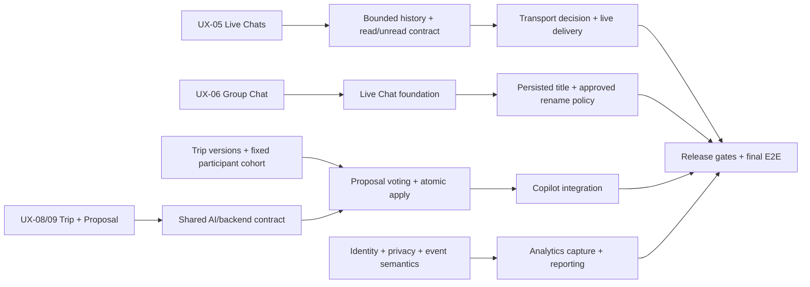

# Pre-Beta Architecture & Contract Review

> Read-only audit of repository `develop` at `5bc522538ae31271d3b26997783007281ff3fe3a`. Runtime findings below describe code and migrations at that revision; approved logical contracts and future requirements are labelled separately. This review changes no application, API, database, or security contract.

Evidence paths are repository-relative. Short `routers/`, `schemas/`, `auth/`, `dependencies.py`, and `db.py` references under backend sections mean `apps/backend/src/travel_friend_backend/`; `lib/` and `components/` references in frontend evidence mean `apps/mini-app/lib/` and `apps/mini-app/components/`. Migration filenames without a prefix resolve under `supabase/migrations/`. `pre-beta-development-plan.md` resolves under `docs/`; short `backend/...` design references resolve under `docs/backend/`.

## Stage 4 follow-up — 2026-11-06

The review below remains a historical audit of its stated `develop` revision. Product decisions have since been approved: title is optional and limited to 80 Unicode code points, blank is displayed as «Групповой чат», any active group participant may rename, and simultaneous changes use last-write-wins. Stage 4 adds only title persistence/read/rename; it does not change membership, AI/Proposal, Trip, or the RLS boundary. Implementation and checks pass in this branch on disposable PostgreSQL; no shared environment migration or deployment was performed.

## Executive Summary

The current application has a working, persisted HTTP baseline: the Next.js Telegram Mini App calls a FastAPI backend; the backend validates raw Telegram `initData`, resolves an opaque Bearer session, binds the authenticated UUID to a transaction-scoped PostgreSQL context, and invokes narrowly scoped database capabilities. PostgreSQL/Supabase is the system of record. Current runtime includes Discover decisions/Match creation, direct and fixed-roster group Chats, ordered persisted messages, and Trip creation/read.

Live delivery, bounded message-history reads, Chat preview/unread read models, group titles/rename, Proposal, AI Copilot runtime, and analytics ingestion are not implemented at the audited revision. Their approved target requirements remain in the [Pre-Beta Development Plan](pre-beta-development-plan.md) and [Backend Contracts](backend/backend-contracts.md); they must not be described as existing runtime.

No finding requires a broad rewrite or blocks unrelated product work. Before the relevant feature loops, the team must settle the specific contracts and limits listed below. Proposal implementation is blocked until its shared AI/backend contract is agreed. The remaining current architecture is adequate for its documented HTTP MVP scope.

**Live Chats recommendation:** start with bounded polling over the existing authenticated backend boundary, but only after adding sequence-cursor reads and a bounded history contract. Keep persisted messages as source of truth. Consider SSE if observed latency/request cost makes polling inadequate and a cross-instance notification path is available. Supabase Realtime would require an explicitly reviewed identity/RLS bridge; WebSockets add connection and fan-out operations without a current bidirectional requirement.

## Current Architecture Map

| Area | Implemented runtime | Approved design / future work |
|---|---|---|
| Frontend | Next.js Mini App; screen components call a typed same-origin backend client and hold transient screen/form state. Telegram auth bootstrap gates product screens. (`apps/mini-app/lib/backend-api-client.ts`, `components/TelegramAuthBootstrapProvider.tsx:46-106`) | UI displays server-owned domain state. No browser-to-database authority or AI/provider calls. |
| Backend | FastAPI routers for auth, profile/onboarding, Discover, Chats/messages, and Trips. Request handlers use authenticated dependencies and PostgreSQL transactions/capabilities. (`apps/backend/src/travel_friend_backend/main.py:35-51`; `dependencies.py:16-27`) | Backend/domain remains the trust boundary for authorization, invariants, orchestration, and durable writes. |
| Identity/security | Backend verifies raw Telegram `initData`; opaque Bearer sessions are resolved server-side. Business transactions bind the principal UUID with transaction-local `app.user_id`. (`main.py:63-83`; `auth/service.py:53-80`; `db.py:23-33`) | Current RLS and security-definer capabilities are implemented by migrations; additions require narrow, reviewed grants/policies. Do not expose runtime DB credentials or treat client identity as authority. |
| Database | Supabase PostgreSQL stores users/sessions, Discover decisions/Matches, Chats/participants/messages, Trips/participants/stops. Message sequence and Trip block/membership versions are persisted. (`20260901130000_chat_persistence.sql:1-67`; `20260901140000_trip_persistence.sql:1-58`) | Physical design beyond these migrations is design input, not a shipped schema. |
| Deployment/CI | Repository runbooks describe Vercel frontend, Render FastAPI backend, and Supabase PostgreSQL. CI runs frontend `npm run check` and backend tests against disposable PostgreSQL (`.github/workflows/ci.yml:10-63`). | Deployment runbook observations are dated; exact live SHAs, settings, and schema parity must be rechecked at release gates, not inferred from this audit. CI does not provide deployed multi-user E2E. |
| AI / analytics | No AI router/orchestrator, Proposal persistence/API, analytics SDK, event router, or analytics migration exists in the audited application/migration inventory. | AI + baseline Proposal and product analytics are mandatory before the external test, but are not implemented yet (`pre-beta-development-plan.md:90-116`). |

The current backend is deliberately compact rather than layered into repositories/services: endpoint logic and transaction-scoped SQL capabilities are visible in routers/migrations. No evidence in this review justifies introducing a generic repository/UoW or replacing the existing security boundary.

## Live Chats Readiness

### Current behavior and boundaries

- `GET /chats/{chat_id}/messages` verifies active Chat membership and returns visible messages ordered by `sequence_number`; the backend currently returns the entire history without cursor or limit (`apps/backend/src/travel_friend_backend/routers/chats.py:224-240`; `docs/backend/backend-contracts.md:66,72`). The migration has `UNIQUE(chat_id, sequence_number)` and a descending per-chat sequence index (`20260901130000_chat_persistence.sql:37-58`).
- Message sends go through `send_current_chat_message`; the database capability locks Chat state, assigns sequence, and inserts the message in a transaction (`routers/chats.py:243-269`; `20260901260000_chat_rls.sql:172-250`). Tests cover persisted ordering and concurrent sequence allocation (`apps/backend/tests/test_chat_messages.py:288-309`). This protects ordering, not retry idempotency.
- RLS limits message reads to active participants, while the API derives the actor from the Bearer session (`20260901260000_chat_rls.sql:28-78`; `dependencies.py:16-27`). This is suitable for the current HTTP reads/writes.
- `GET /chats` currently returns Chat and participant projections; it does not return last-message preview or unread counts. It first queries chats and then makes participant projection reads per Chat (`routers/chats.py:134-155`). The Mini App loads Chats once and has loading/error/empty states, but no live refresh (`apps/mini-app/app/chats/page.tsx:29-60`).
- `chat_participants` already stores `last_read_sequence` and `last_visible_message_sequence`, and a trigger prevents those counters moving backwards (`20260901130000_chat_persistence.sql:16-33,147-167`). There is no current read/unread API, no persisted unread projection, and the contract explicitly records that gap (`backend-contracts.md:70-72`). Columns alone do not mean the feature exists.

### Transport comparison and recommendation

| Option | Fit for this repository | Main cost / condition |
|---|---|---|
| **Bounded polling — recommend first** | Reuses FastAPI, Bearer auth, RLS/capability checks, HTTP deployment, and persisted message order. Sending can remain an HTTP write; the server remains authoritative. | Must first add bounded initial history and `after_sequence`/cursor resync. Poll only while a Chat is visible, pause in background, back off on failures, and measure request/row cost. Current full-history response must not be polled repeatedly. |
| SSE — alternative | One-way server-to-client message delivery while sends remain HTTP; supports event IDs based on sequence for reconnect. | Requires an authenticated stream endpoint, connection limits/timeouts, and a notification/fan-out path shared across Render instances. Durable resync still needs the cursor read API; an in-process notification alone is insufficient. Revisit if polling cost or latency misses beta needs. |
| Supabase Realtime | Could deliver database changes close to write time. | Current clients authenticate with a custom opaque Telegram Bearer session; the backend sets a transaction-local principal for database calls. There is no reviewed browser-to-Supabase identity bridge. Direct subscriptions would require explicit JWT/RLS and channel authorization design and would cross the current boundary. Not the minimal first option. |
| WebSocket | Supports two-way event streams. | Current message command is request/response HTTP; no requirement needs bidirectional stateful sessions. Adds connection auth, reconnect, fan-out, and operational handling. Reconsider only if later product needs justify those costs. |

### Live Chats findings

| ID | Finding / evidence | Severity and Pre-Beta link | Minimum action |
|---|---|---|---|
| L-01 | Message history is unbounded and has no cursor. Evidence: `routers/chats.py:224-240`; `backend-contracts.md:66,72`. | **REQUIRED BEFORE FEATURE** — Live Chats stage 3, history bounds/performance. | In the Live Chats loop, specify a bounded initial history and sequence-cursor resync/read contract. Keep it in the same backend authorization boundary and test gaps, overlap, and reconnect. |
| L-02 | Chat list lacks last-message/time and unread read model; participant projection uses per-Chat follow-up reads. Evidence: `routers/chats.py:134-155`; `chat_persistence.sql:16-33`; `backend-contracts.md:70-72`. | **REQUIRED BEFORE FEATURE** — UX-05 / Live Chats stages 3–4. | Agree unread semantics and a bounded/batched Chat summary projection before implementation. Include last message, timestamp, and unread count/read marker; evaluate query plan and response size. Do not treat existing sequence columns as a complete unread feature. |
| L-03 | Message POST has no idempotency key. A client retry after an ambiguous network outcome can persist another message; UI preserves draft on failure (`schemas/chats.py:77-92`; `lib/chat-runtime.ts:103-125`). Sequence locking prevents ordering races but not duplicate sends (`20260901260000_chat_rls.sql:202-250`; `test_chat_messages.py:288-309`). | **REQUIRED BEFORE FEATURE** — Live Chats stage 2/4, before automatic resend or reconnect-driven retry. | Define send retry semantics and a minimal idempotency/deduplication key if the UX will retry unknown outcomes. Deduplicate delivered events by stable `message_id`/sequence. Do not mistake sequence assignment for request idempotency. |
| L-04 | Current authorization and persisted ordering match the current contract; no live transport exists. | **NO ACTION** for current HTTP MVP; transport selection is a planned feature decision, not a defect. | Preserve the current session → principal → transaction-local DB context → RLS/capability flow. No change to auth/RLS is justified for the polling recommendation. |

## Group Chats Readiness

### Current behavior

The current API creates a new group from 2–20 unique eligible companions (the initiator is added by the backend). Each companion must have an existing matched direct Chat with the initiator. The SQL capability verifies that eligibility and inserts one group Chat plus the fixed participant set (`apps/backend/src/travel_friend_backend/routers/chats.py:51-85`; `20260901260000_chat_rls.sql:80-170`). The group response contains IDs and participants/count, but no name/title (`schemas/chats.py:37-75`). No API changes membership after creation. Existing tests cover eligibility, rejected inputs, and persistence (`apps/backend/tests/test_chats.py:268-356`; `test_chats_contract.py`).

Trip creation locks Chat and participants, creates one unfinished Trip per Chat, and snapshots every active Chat participant into Trip participants in the same database capability (`20260901270000_trip_rls.sql:76-121`; `backend-contracts.md:79-81`). Group Chat and Trip membership are distinct resources; current Trip participants derive from the Chat roster at Trip creation. This matches the current fixed-roster design. Proposal voting should use the approved active TripParticipant cohort frozen at Proposal creation, not dynamically recalculate voters from Chat membership (`backend-contracts.md:203-213`).

### Findings

| ID | Finding / evidence | Severity and Pre-Beta link | Minimum action |
|---|---|---|---|
| G-01 | Persisted group title/create/rename is absent from schemas, routes, and `chats` insert; physical design explicitly records the UX-06 delta as needing focused contract/schema review (`schemas/chats.py:37-75`; `routers/chats.py:51-85`; `20260901260000_chat_rls.sql:156-165`; `physical-data-design.md:9-13`). | **REQUIRED BEFORE FEATURE** — Group Chats stage 4. | Define the title field, create/read/update API, and length/blank/conflict behavior in focused contract review before implementation. Keep roster immutable; do not add invitations, leave/remove, or admin roles. |
| G-02 | Rename authorization is not specified; current group creation does not persist a creator field. | **BLOCKER for the rename implementation loop only** — explicit open decision in `pre-beta-development-plan.md:80-88`. | Proposed minimal policy for approval: any **current active group participant** may rename, with the backend validating membership. This adds no role hierarchy. If creator-only is preferred, a durable creator identity must first be designed; do not infer it from Trip creator or client state. |
| G-03 | Current fixed roster and Group→Trip snapshot behavior are tested and align with current MVP. | **NO ACTION** for current membership baseline. Mutable membership remains deferred. | Keep the present roster immutable for first beta. Any future membership lifecycle needs a separate decision covering Trip participants, pending Proposals/votes, and historical access. |

## Proposal / Trip / AI Boundaries

### Current runtime versus approved logical design

Current runtime supports Trip creation and reads only. A partial unique index enforces one unfinished (`forming`/`active`) Trip per Chat; creation is a scoped capability, not a general Trip update API (`20260901140000_trip_persistence.sql:1-47`; `routers/trips.py:89-123`). The Trip stores `created_by_user_id` as attribution; current API has no creator-only mutation route. It also stores `membership_version`, `state_version`, and per-block versions/statuses (`trip_persistence.sql:5-15`). The current Mini App cannot update confirmed Trip fields.

Approved logical design says Proposal is the path to change confirmed Trip state: one Proposal addresses one block; voters are fixed from active Trip participants; a vote is one-time; any rejection rejects; acceptance requires unanimity; stale Proposal does not mutate Trip; accepted Proposal and Trip update are atomic; only one pending Proposal per block (`backend-contracts.md:195-223`). AI/ML can analyze and create candidate results but cannot write Trip or apply Proposal and has no direct HTTP or application-secret access (`backend-contracts.md:225-260`; `backend/ai-architecture.md:54-103`).

The logical design also describes asynchronous `AIRequest` statuses and user-triggered requests; its exact shared schema/API is explicitly pending review (`backend-contracts.md:229-260`; `pre-beta-development-plan.md:90-104`). None of these states should be represented as implemented until routes, persistence, auth, and tests exist.

### Findings and shared AI contract

| ID | Finding / evidence | Severity and Pre-Beta link | Minimum action |
|---|---|---|---|
| P-01 | Trip versions and creation/read runtime exist, but no Trip block update or Proposal/AI routes, tables, or persistence exist (`main.py:25-51`; `routers/trips.py:25-123`; current migration inventory). | **REQUIRED BEFORE EXTERNAL TEST** — Proposal/AI baseline UX-09, section 5. | Implement as a distinct feature loop after shared contracts; do not introduce generic Trip writes or creator-only authority. Test state preservation until unanimous acceptance. |
| P-02 | Logical Proposal invariants are approved, but concrete AI output ↔ Proposal API/result/error semantics and shared ownership details remain to be agreed (`pre-beta-development-plan.md:92-104`). | **BLOCKER for shared Proposal/AI implementation**; design can proceed in parallel with Live Chats. | Before code/schema changes, agree the minimum interface below with the AI developer. Keep each domain owner and API boundary explicit. |

**Minimum shared contract to agree before Proposal implementation:**

1. **Request/response envelope:** request correlation/idempotency identifier; supported trigger and Chat/Trip context; asynchronous `AIRequest` status/result/error and retry/timeout semantics; ownership of retries and usage accounting.
2. **Context and security:** normalized allowlisted message/Trip context; authenticated initiating user and authorized Chat/Trip established by backend; explicit input size and data-minimization policy. AI receives no session secrets, provider credentials, direct DB access, or apply capability.
3. **Structured candidate output:** allowed block type, proposed full block snapshot, provenance/source, validation errors, and stable request/result IDs. Backend validates the output against current Trip schema and current block/membership versions; model output is untrusted input.
4. **Proposal handoff:** backend records origin and `AIRequest` linkage, base versions and a fixed voter cohort. AI returns a proposal candidate; it does not create votes, decide acceptance, or update Trip.
5. **Apply concurrency:** define the stale result when block or membership versions changed; reject/review rather than overwrite. Voting, unanimous terminal state, version check, and Trip apply must be one backend-owned atomic operation; concurrent votes/retries must not double-apply.

The plan already requires version/stale, idempotency, authorization, atomic apply, and concurrent tests. This review does not choose HTTP/gRPC/queue/process topology or alter those logical contracts.

## Product Analytics Readiness

There is no analytics SDK or event-ingestion route/service/table in the current application. CI verifies frontend and backend test suites but has no analytics or deployed E2E check (`.github/workflows/ci.yml:10-63`). Durable sources already exist for account UUID, onboarding status, Discover decisions/Match, messages, and Trips. Candidate views and Trip opens are not durable domain events; Proposal events do not exist until that feature is implemented.

Use the internal `users.id` UUID as the analytics identity if approved. Do not send raw Telegram IDs, Bearer tokens, message contents, names, destinations, profile fields, or arbitrary prompt/provider payloads to analytics. Browser-emitted events must not be treated as authoritative security facts. Event capture should be non-blocking relative to chat/match/Trip transactions; any database path requires its own narrow authorization/write surface. These constraints follow the existing Telegram auth and runtime DB boundary (`auth/service.py:53-80`; `dependencies.py:16-27`; `backend/security.md:64-109`).

| Option | Benefit | Cost / decision |
|---|---|---|
| PostHog | Fast path to funnels, cohorts, and retention views with little custom reporting code. | Select only after team approves processor/hosting region, consent/privacy, identity handling, retention, event sanitization, cost, and failure behavior. Avoid synchronous event calls in core user operations. |
| Minimal owned tracking | Maximum control over fields/retention and can use durable backend entities for derived metrics. | Requires an event schema, authenticated/validated ingestion, deduplication, retention/deletion policy, query/report ownership, and possibly a small aggregate view. It is not simply direct browser writes to a table. |

**Recommendation:** first define the event semantics and privacy/retention choices from plan section 6. Derive metrics from persisted domain resources where that is accurate; add explicit low-cardinality events only for missing funnel actions (such as a candidate actually opened). Defer vendor choice until the team knows whether cohort dashboards are necessary for the first test. If needed, choose PostHog after processor/privacy approval; otherwise start with narrow backend-owned tracking or reproducible queries. Analytics is **not a blocker** for Live Chats, Group Chat, or Proposal engineering, but it is **REQUIRED BEFORE EXTERNAL TEST** by plan stage 6.

## Findings Matrix

| ID | Finding | Evidence | Severity | Pre-Beta disposition |
|---|---|---|---|---|
| L-01 | Unbounded message history; no sequence cursor. | `routers/chats.py:224-240`; `backend-contracts.md:66,72` | REQUIRED BEFORE FEATURE | Add bounded reads/resync in Live Chats loop. |
| L-02 | Missing last-message preview and read/unread summary; Chat list has per-Chat participant reads. | `routers/chats.py:134-155`; `chat_persistence.sql:16-33`; `backend-contracts.md:70-72` | REQUIRED BEFORE FEATURE | Agree unread semantics and build bounded/batched summary. |
| L-03 | Message retry after ambiguous failure is not idempotent. | `schemas/chats.py:77-92`; `lib/chat-runtime.ts:103-125`; `send_current_chat_message` in `20260901260000_chat_rls.sql:202-250` | REQUIRED BEFORE FEATURE | Define retry/idempotency before automatic resend/reconnect. |
| G-01 | Group create/read contracts do not persist a user title. | `schemas/chats.py:37-75`; `routers/chats.py:51-85`; `physical-data-design.md:9-13` | REQUIRED BEFORE FEATURE | Focused title contract/schema review. |
| G-02 | Rename authorization is unset and creator identity is not stored. | `create_current_group_chat` in `20260901260000_chat_rls.sql:156-165`; `pre-beta-development-plan.md:80-88` | BLOCKER for rename loop only | Team approves active-participant or another explicit policy before implementation. |
| P-01 | Proposal/AI runtime and persistence are absent. | `main.py:25-51`; `routers/trips.py:25-123`; `backend-contracts.md:81,84` | REQUIRED BEFORE EXTERNAL TEST | Implement baseline AI + Proposal with release E2E. |
| P-02 | Shared AI/Proposal transport/schema/error contract is incomplete. | `pre-beta-development-plan.md:92-104`; `backend-contracts.md:225-260` | BLOCKER for shared Proposal/AI loop | Agree shared request, output, validation, stale, retry, and apply contract first. |
| A-01 | Product event capture and analytics decisions are absent. | No analytics runtime in app/router/migration inventory; `pre-beta-development-plan.md:106-116` | REQUIRED BEFORE EXTERNAL TEST | Define identity/events/privacy/retention/reporting; select PostHog vs owned path after review. |
| N-01 | Current HTTP auth, participant checks, ordering and scoped capabilities meet current MVP contracts. | `auth/service.py:53-80`; `dependencies.py:16-27`; `chat_rls.sql:68-78`; `test_chat_messages.py:288` | NO ACTION | Preserve current boundary; no security redesign indicated. |

`BLOCKER` applies only to the named shared implementation loop; it does not block independent Live Chats work or product/design clarification. The plan’s release gates remain separate and pending; this architecture review does not certify production readiness.

## Dependency Map

## Cross-Team Contract Questions

1. **Group Chat:** what is the persisted title’s blank/length/update behavior? Who may rename? Proposed policy: any active participant; approval required. Are rename collisions handled by last-write-wins or a version conflict? Do not assume creator/admin role.
2. **AI/Proposal:** approve the shared contract items listed above: normalized context, allowed structured outputs, ownership of AIRequest and Proposal persistence, retry/idempotency, version snapshot/stale outcomes, and exact atomic vote/apply boundary. The backend remains the only domain authority.
3. **Analytics:** define active-user windows/timezone, unique event IDs/deduplication, consent/processor policy, field allowlist, retention/deletion, report access, and operational owner before choosing PostHog or owned tracking.

### Live Chats decision update — 05.11.2026

The team has decided bounded HTTP polling, persisted messages as the source of truth, a bounded initial page with before/after sequence cursors, own-message-excluded unread counts, read watermark advancement after display in the active Chat Room, and stable request IDs for retry-safe sends. The implementation is in progress; these decisions do not certify the feature or production rollout. Earlier L-01…L-03 rows and runtime descriptions above remain historical findings for the audited revision in the header.

## Recommended Implementation Order

1. **Live Chats transport and read contract:** implement the decided bounded polling and sequence-based history/read APIs. Keep sends HTTP and persisted history authoritative.
2. **Live message refresh:** visible-screen polling, backoff/background pause, sequence-based merge/deduplication, reconnect/resync, and explicitly tested ambiguous-send retry behavior.
3. **Chats list summary + unread:** implement last message/time/unread in the existing participant visibility boundary; verify query plan, N+1 behavior, and load cost.
4. **Group title/rename:** resolve title constraints and rename authorization; only then update persisted create/read/rename contracts and UI. Retain fixed roster; keep this slice independent from mutable membership.
5. **Proposal/AI contract alignment:** AI developer and backend owner agree shared request/result, validation, version, stale, idempotency, and atomic apply boundaries before shared schema/API changes. UI can be designed in parallel; implementation follows the approved contract.
6. **Proposal persistence/voting/apply and Copilot integration:** server-side auth and fixed voters, version checks, unanimous decisions, stale handling, transactionally atomic apply, duplicate/concurrency tests, and controlled-output E2E. AI never directly mutates Trip.
7. **Analytics design in parallel with stages 1–6; implement before external test:** derive from persisted sources where semantics fit, add only necessary events, approve privacy/retention and reporting path, and verify duplicate-free non-blocking capture.
8. **Release gates:** complete the applicable security, deployment provenance, backup/recovery, smoke, cost/abuse, AI guardrail, and final end-to-end gates in `pre-beta-development-plan.md:118-132` before an external cohort.

## Residual Risks

- There is no live multi-user/reconnect E2E for transport, cursor resync, unread counts, or concurrent message retry because those features are not implemented. Existing tests validate current HTTP persistence, ordering, membership authorization, and concurrent sequence allocation only.
- The documented Vercel/Render/Supabase topology and deployment observations are not a current-live inventory. Reconfirm provider revisions/settings, environment wiring, and applied migration ledger at release preflight.
- Current `GET /chats` and message-history APIs return unpaged results; their present MVP contracts bound neither chat count nor message history. The planned response/query caps and usage/cost checks must be part of Live Chats acceptance.
- The security model documents that transaction-local `app.user_id` is not per-user containment if the `app_runtime` database credential is compromised and used for arbitrary SQL (`docs/backend/security.md:105-107`). This accepted trust boundary is unchanged; protect runtime credentials and preserve narrow app query/capability surfaces.
- The logical Proposal/AI design is detailed enough to preserve core invariants but not sufficient to let two teams independently invent a shared runtime contract. Do not implement shared schema/API until the cross-team contract is approved.
- Analytics measures can misstate user behavior if API calls are treated as views/opens. Define event semantics and identity/privacy before using them for product decisions.

## Self-Review

- Runtime claims are grounded in current source, tests, and migrations; logical Proposal/AI requirements are labelled as target design, not shipped behavior.
- UX-01…UX-10 statuses in the plan remain product decisions, not implementation completion. This document does not reopen closed UX tasks.
- AI Copilot and baseline Proposal remain mandatory before first external test; neither is described as implemented or future-only.
- Recommendations are limited to planned Live Chats, Group Chat, Proposal/AI, analytics, and release-readiness needs. No application code, contract, migration, deployment, security boundary, or other document was changed.
- Existing auth, RLS, and capability boundaries are treated as constraints. Deferred group membership lifecycle, provider purchases, and a generic architecture refactor are not proposed.
